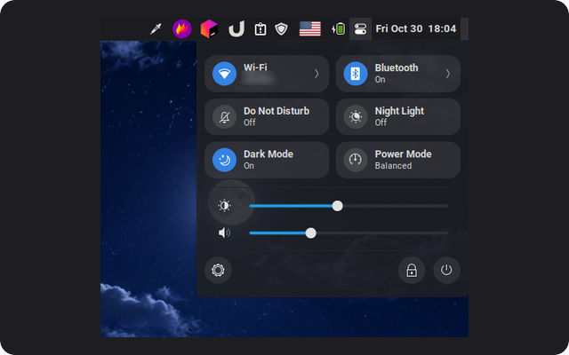
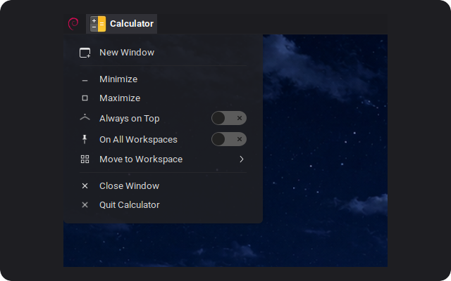
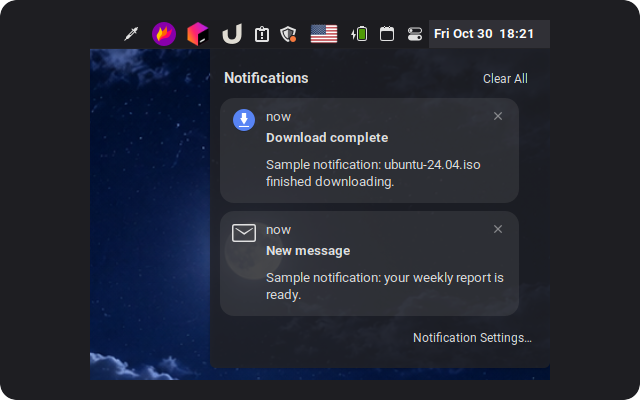
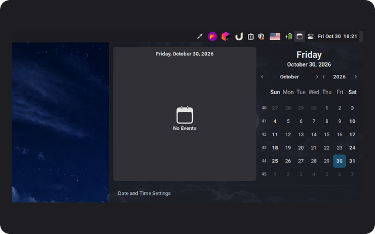

# cinnamon-applets

Panel applets for the Cinnamon desktop that bring a bit of macOS to Linux Mint.

<table>
  <tr>
    <td width="50%" valign="top">
      <a href="quick-settings@Dimitry4Now"><b>Quick Settings</b></a><br>
      <br>
      Control center: Wi-Fi and Bluetooth with network and device lists, Do Not Disturb, Night Light, Dark Mode, power mode, brightness and volume.
    </td>
    <td width="50%" valign="top">
      <a href="app-menu@Dimitry4Now"><b>App Menu</b></a><br>
      <br>
      The focused app's icon and name in the panel, with window and app actions: new window, minimize, keep on top, move to workspace, quit.
    </td>
  </tr>
  <tr>
    <td width="50%" valign="top">
      <a href="notification-center@Dimitry4Now"><b>Notification Center</b></a><br>
      <br>
      The clock opens your notifications, with an unread dot and Clear All. Replaces the Notifications applet.
    </td>
    <td width="50%" valign="top">
      <a href="calendar-icon@Dimitry4Now"><b>Calendar Icon</b></a><br>
      <br>
      A calendar icon that opens Cinnamon's month calendar and your events.
    </td>
  </tr>
</table>

## Install

```bash
git clone https://github.com/Dimitry4Now/cinnamon-applets.git
cd cinnamon-applets
./install.sh
```

Then add the applets to a panel: right-click the panel → **Applets**.

To install just one, pass its UUID: `./install.sh app-menu@Dimitry4Now`.

## Development

`./install.sh --link` symlinks the applets instead of copying them, so edits in the repo take effect once you reload the applet. Right-click it → Reload, or restart Cinnamon with Ctrl+Alt+Esc. Errors show up in Looking Glass (Alt+F2 → `lg`) and in `~/.xsession-errors`.

Each applet uses the [Cinnamon Spices](https://cinnamon-spices.linuxmint.com) layout (`<uuid>/info.json`, `<uuid>/README.md`, `<uuid>/files/<uuid>/`), so it can be submitted there as is.

## License

GPL-3.0. See [LICENSE](LICENSE).
