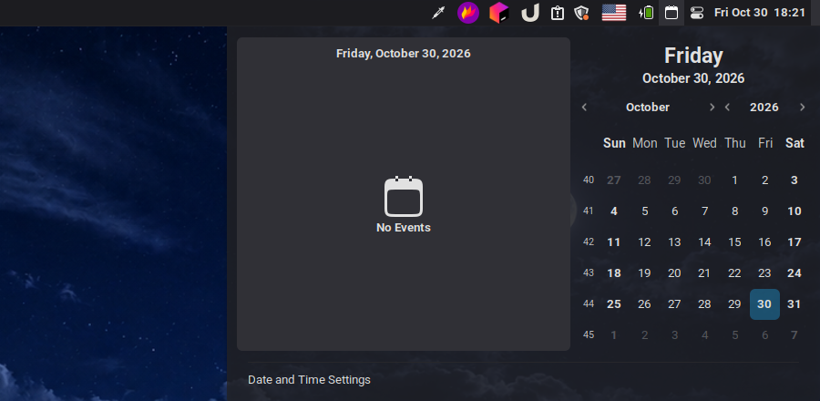

# Calendar Icon

A calendar icon for the panel. Clicking it opens Cinnamon's month calendar and your events: the same view the stock Calendar applet shows from the clock.

Use it with [Notification Center](../notification-center@Dimitry4Now), which turns the clock into the notification button the way macOS does.

It reuses the calendar and event list from Cinnamon's built-in Calendar applet (`/usr/share/cinnamon/applets/calendar@cinnamon.org`), so it keeps your theme's calendar styling and shows events from your calendar accounts.

## Settings

- Show events
- Show week numbers
- Keyboard shortcut to open it (default Super+C, same as the stock Calendar applet)
