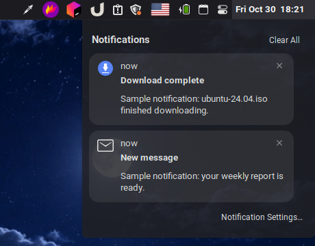

# Notification Center

The panel clock, macOS style: click it to see your notifications.

- Newest notifications first, with how long ago each arrived and a close button per card
- **Clear All**, and a link to Notification Settings
- A small blue dot next to the clock while unread notifications are waiting; it goes away once you open the list
- Keyboard shortcuts: Super+N opens the list, Shift+Super+C clears it (same defaults as Cinnamon's Notifications applet)

It takes over Cinnamon's notifications role, so it **replaces the Notifications applet**: remove that one from the panel first. Pair it with [Calendar Icon](../calendar-icon@Dimitry4Now) if you also want the calendar that used to open from the clock.

## Settings

- Clock format (strftime, default `%a %b %e  %H:%M`, e.g. `Thu Oct 30  18:04`)
- Show the unread dot
- Don't keep transient notifications
- Keyboard shortcuts
